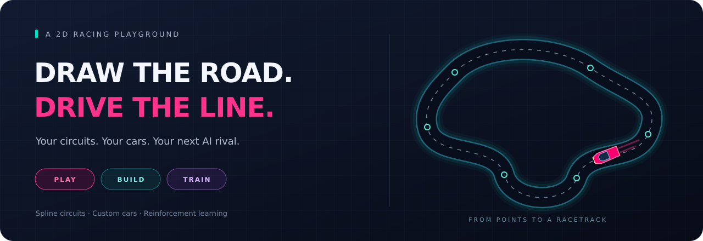
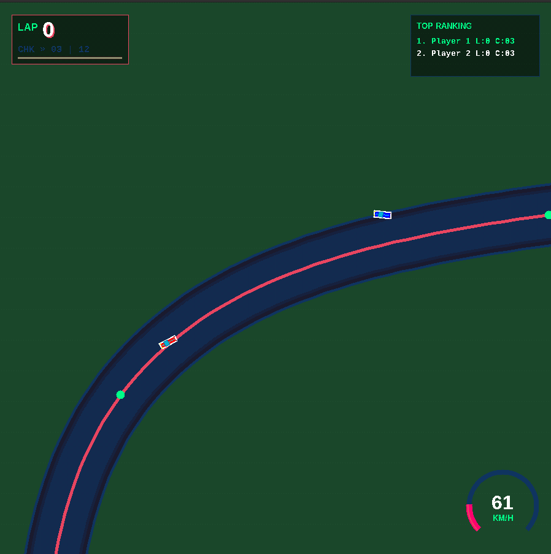
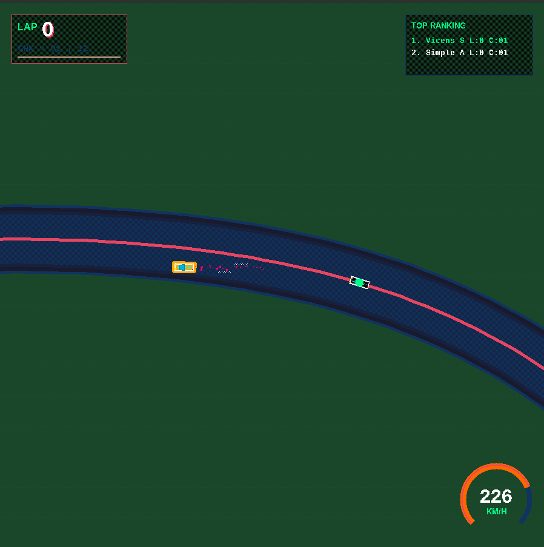
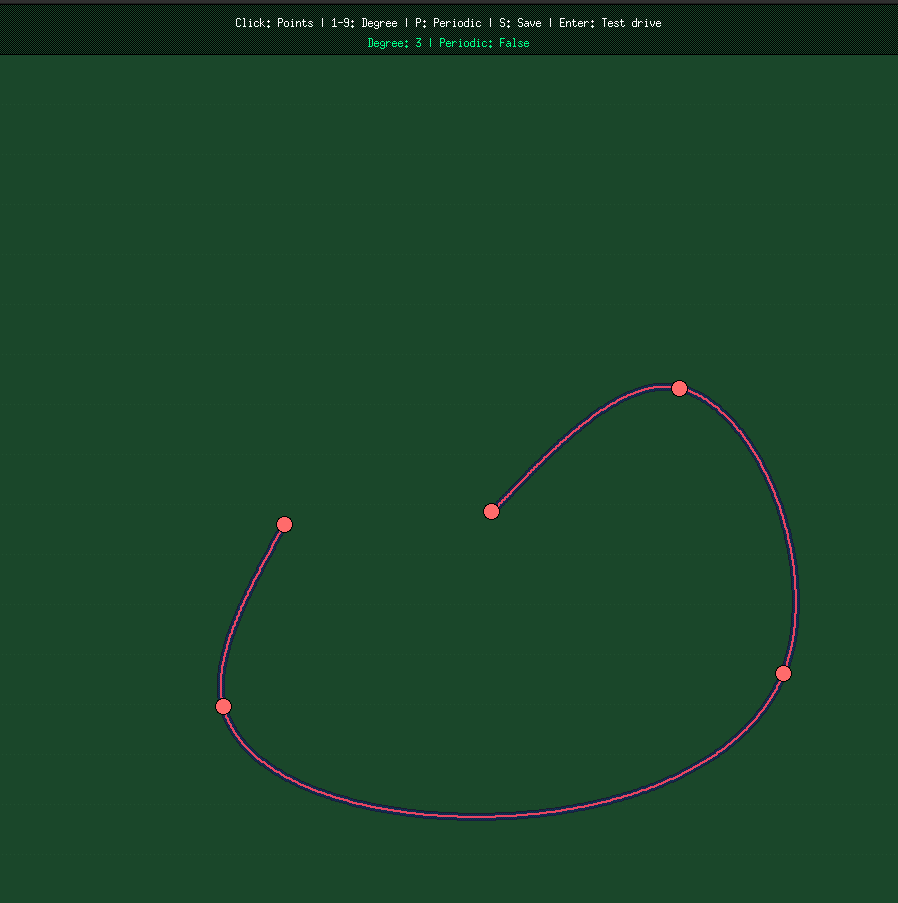

# Racing Game

<p align="center">
  
</p>

<p align="center">
  <strong>Build a track. Make it yours. Race a friend. Train your next rival.</strong>
</p>

<p align="center">
  <a href="#quick-start">Play</a> ·
  <a href="#your-points-your-racetrack">Build roads</a> ·
  <a href="#make-the-car-your-own">Customize cars</a> ·
  <a href="#teach-a-bot-to-drive">Train bots</a>
</p>

**Racing Game is a 2D racing game built with Python and Tkinter**, with a track editor, configurable cars and drivers trained through reinforcement learning.

Take on the campaign, share a keyboard with a friend, or draw a road and see how it feels behind the wheel. Then let a PPO agent learn to drive using the same car physics.

## One game, plenty to experiment with

| 🏁 Race | ✏️ Create | 🧠 Train |
| --- | --- | --- |
| Four campaign tracks, solo driving and local two-player races. | Draw open roads or closed circuits, change their curves and save your designs. | Watch a trained bot, race against it, or train a new driver on your own tracks. |

The look is all neon: glowing roads, colorful cars, brake lights, speed trails and drift sparks. Underneath, the handling combines acceleration, braking, lateral grip and different behavior on and off the asphalt.

<table>
  <tr>
    <td width="50%" align="center">
      
      <br><strong>Race a friend.</strong><br>One keyboard, two cars, a shared track.
    </td>
    <td width="50%" align="center">
      
      <br><strong>Challenge the bot.</strong><br>Take on a driver trained with reinforcement learning.
    </td>
  </tr>
</table>

## Your points, your racetrack

The editor turns the points you place into a driveable road. Build a straight sprint, an oval, a flowing loop or something much less forgiving.

**The curves are part of the design.** Change the interpolation degree and toggle between an open road and a closed circuit to reshape the track, with a live preview as you edit.

| Road geometry | How it works |
| --- | --- |
| **Natural cubic splines** | Open roads at degree 3 use SciPy's `CubicSpline` with natural boundary conditions. |
| **Interpolating B-splines** | Other open-road degrees use `make_interp_spline`, giving you different ways to connect the points. |
| **Periodic splines** | Closed circuits use periodic boundary conditions to join the end back to the start. |

The spline implementation is selected from the degree and whether the road is closed. The editor accepts degree keys `1–9`, limits the degree to the available points and attempts a fallback when an interpolation cannot be built.

That same geometry also tells the game whether a car is on the road and gives the AI information about road direction, lateral position and the curve ahead.

<p align="center">
  
  <br><em>A handful of points becomes your next road. Change the degree, close the loop, then take it for a drive.</em>
</p>

### From a blank canvas to a race

1. Press **3** in the menu to open the editor.
2. **Click** to add points; click near an existing point to remove it.
3. Use **1–9** to change the degree and **P** to toggle a closed circuit.
4. Press **S**, then type a name **in the terminal**, without `.json`.
5. Return to the menu with **Esc** and press **4** to race your saved track.

Use at least two distinct points, save the track and open it through mode 4 to race it.

Track designs are plain JSON, so you can also adjust road width and edit their points outside the game.

## Make the car your own

A track is only half the experiment. Change the car and the same corner becomes a different challenge.

Car definitions are editable JSON: choose a color and dimensions, then tune top speed, acceleration, steering and grip. Try a car that holds its line, a loose setup that slides through corners, or a fast car that demands more careful braking.

| Setting | What you control |
| --- | --- |
| `color`, `width`, `height` | The car's appearance and proportions. |
| `max_speed` | Top speed, in km/h. |
| `acceleration` | The 0–100 km/h time used to calculate acceleration. Lower means quicker. |
| `turn_speed` | Steering response, in radians per second. |
| `grip` | Lateral grip and how readily the car slides. |
| `controls` | Arrow keys or the `wasd` control scheme. |

Edit [the solo car](data/cars/one_player.json), [the two-player setup](data/cars/two_players.json), or [the training cars](training/training_data/cars_for_training/) to try your own setup.

Global surface friction, road grip, camera behavior and colors live in [`core/config.py`](core/config.py). Changing the car or the physics also changes the task your AI driver has to learn.

## Teach a bot to drive

The AI uses **Proximal Policy Optimization (PPO)** through Stable-Baselines3, with a Gymnasium environment built around the game's physics.

Each driver receives:

- **Seven distance sensors** looking for the road edges.
- **Six driving signals** describing speed, rotation, lateral movement, road alignment and the bend ahead.
- **Four observations stacked over time**, giving the included policy 52 input values.

It outputs continuous steering, throttle and braking. Training rewards progress and speed, penalizes time and ends the episode when the car leaves the road. Multiple circuits can be used in parallel, with selection weighted toward tracks with fewer successful runs.

**A trained checkpoint is included**, so you can watch the bot in mode **5** or challenge it in mode **6** immediately after installation. Mode 5 is an AI demonstration; learning runs separately from Python.

To try a small training session from the project root:

```bash
python -c "from training import start_training; start_training(car_name='default_ai', circuit_names=['ovalo'], output_model_name='ppo_ovalo_demo', n_envs=1, n_stack=4, total_timesteps=100_000)"
```

This saves a new model and its configuration under `training/models/`. See the [training guide](docs/TRAINING.md) for custom tracks, parallel environments, resuming a session and selecting a model in the game.

## Quick start

You'll need **Python 3.10**, `pip`, Tkinter and a graphical desktop session. Dependency versions are pinned in [`requirements.txt`](requirements.txt).

Download or clone the repository, then open a terminal in the folder containing `main.py`.

### Linux / macOS

```bash
python3.10 -m venv .venv
source .venv/bin/activate
python -m pip install -r requirements.txt
python main.py
```

### Windows · PowerShell

```powershell
py -3.10 -m venv .venv
.\.venv\Scripts\Activate.ps1
python -m pip install -r requirements.txt
python main.py
```

Tkinter comes with your Python installation or your system's Tk packages, rather than `pip`. Run `python -m tkinter` to check that it opens a window.

Install the complete requirements file even for solo play: the current game imports the RL stack at startup. Stable-Baselines3 also installs PyTorch as a dependency.

The included checkpoint was saved with NumPy 2. Installing the pinned requirements matters for loading it; an older NumPy environment may open the game but fail to load the bot.

## Pick your race

Use **↑ / ↓ + Enter**, or jump straight in with a number.

| Key | Mode | Jump in for… |
| --- | --- | --- |
| **1** | Campaign Single Player | Four tracks, from a straight sprint to more involved circuits. |
| **2** | Campaign Multiplayer | A friend, one keyboard and a shared camera. |
| **3** | Creating Mode | Designing your next road. |
| **4** | Your Custom Circuits | Racing the tracks you saved. |
| **5** | Training Mode (AI Demo) | Watching the included policy drive. |
| **6** | Player vs AI | Taking on the bot yourself. |

| Action | Player 1 | Player 2 |
| --- | --- | --- |
| Accelerate | ↑ | W |
| Brake | ↓ | S |
| Steer | ← / → | A / D |

Player 2 uses lowercase WASD inputs. **Esc** returns to the menu. **V** switches between follow and overview cameras in modes 1, 2 and 4. Two-player racing is local, with a shared view.

Best times are stored locally by track and car ID.

## See it in motion

Videos of the editor and races are coming soon.

## Under the hood

```text
main.py                    Launch the game
core/                      Physics settings, colors and game states
game/                      Window, modes, race progress, HUD and AI loading
entities/                  Cars, physics, rendering, spline roads and editor
worldview/                 World-to-screen transforms and camera framing
data/                      Player cars, campaign tracks and local game data
training/training_code/    Gymnasium environments and PPO training
training/training_data/    Cars and tracks for learning
training/models/           Included checkpoint and generated models
docs/                      Guides, architecture and project notes
```

**Built with:** Python · Tkinter · NumPy · SciPy · Gymnasium · Stable-Baselines3 · PyTorch.

## Keep exploring

- [Playing, controls, editor and troubleshooting](docs/USAGE.md)
- [Training, checkpoints and resuming experiments](docs/TRAINING.md)
- [Architecture and data formats](docs/ARCHITECTURE.md)

## AI assistance

AI tools helped prepare the README and documentation.
