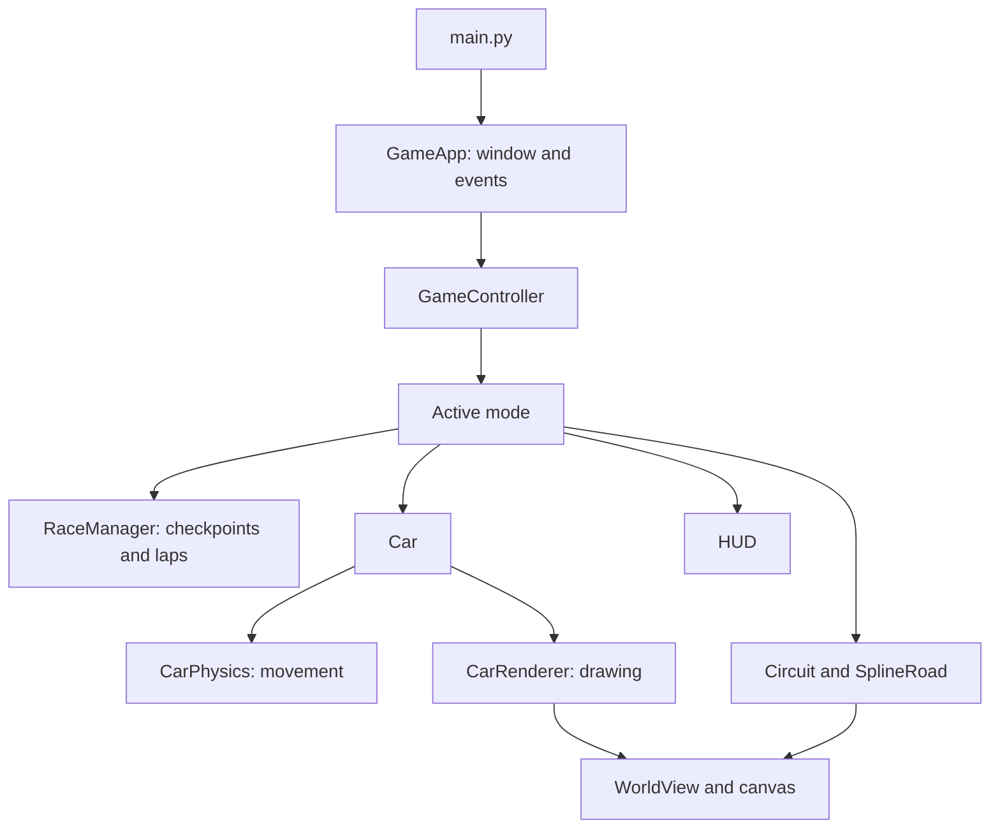

# Architecture and data

The project shares its physics, track geometry and race progress logic between the desktop game and reinforcement learning. The interface uses Tkinter; training uses Gymnasium and PPO from Stable-Baselines3.

## Project structure

| Path | Responsibility |
| --- | --- |
| [`main.py`](../main.py) | Game entry point. |
| [`core/config.py`](../core/config.py) | Colors, physics parameters, window, camera and update frequency. |
| [`core/states.py`](../core/states.py) | States available to the controller. |
| [`game/app.py`](../game/app.py) | Window, canvas, keyboard and mouse events, and update loop. |
| [`game/controller.py`](../game/controller.py) | Mode transitions and delegation of updates, rendering and clicks. |
| [`game/modes.py`](../game/modes.py) | Menu, races, editor, AI demonstration and player versus AI. |
| [`game/race_manager.py`](../game/race_manager.py) | Checkpoints, laps and car progress. |
| [`game/hud.py`](../game/hud.py) | Speedometer, leaderboard, messages and saved records. |
| [`game/model_loader.py`](../game/model_loader.py) | PPO checkpoint loading and inference during gameplay. |
| [`entities/`](../entities/) | Cars, physics, rendering, tracks and track editor. |
| [`worldview/`](../worldview/) | World-to-window coordinate conversion and camera framing. |
| [`training/training_code/`](../training/training_code/) | Active Gymnasium environment, configuration, trainer and model metadata. |
| [`data/`](../data/) | Game cars, campaign tracks and local records. |
| [`training/training_data/`](../training/training_data/) | Cars and tracks used for training. |
| [`training/models/`](../training/models/) | `.zip` checkpoints and `.json` configurations. |

The directory name `data/campaing_circuits` is kept as it appears in the code. Custom tracks are saved in `data/custom_circuits`, which is created when saving from the editor.

## Game flow

`GameApp` tracks pressed keys and schedules the next frame through `root.after()`. Each iteration asks the controller to update and render the active mode. Physics uses a fixed step, `PhysicsConfig.DT`; the application measures elapsed time to report FPS. There is no accumulator that runs additional physics steps to compensate for a slow frame.

`GameController` constructs the modes and calls `enter()` when the state changes. Each mode coordinates its data loading, player input, camera and track progression. The menu's `TrainingMode` runs an existing trained model; learning is launched through the training code. See the [usage guide](USAGE.md) for the available modes and controls.

## Physics, geometry and rendering

- [`Car`](../entities/car.py) combines controls, physics and rendering. It also generates observations for the AI.
- [`CarPhysics`](../entities/car_physics.py) applies acceleration, braking, steering, friction and lateral grip. Inputs are consumed and reset after each step.
- [`CarRenderer`](../entities/car_renderer.py) turns the physics state into canvas polygons and effects. When a car is constructed with `canvas=None`, renderer initialization skips graphical elements.
- [`SplineRoad`](../entities/roads/spline_road.py) interpolates points with SciPy and calculates positions, tangents and distance from the road. It detects a closed track when the first and last points coincide.
- [`Circuit`](../entities/circuit.py) groups roads, checkpoints and distances. [`RaceManager`](../game/race_manager.py) tracks progress by car identifier.
- [`RoadMaker`](../entities/RoadMaker/RoadMaker.py), its manager and its renderer coordinate track editing, previews and export.

Track membership is determined by comparing a position with the sampled centerline and road width. The current physics implementation does not include collisions between cars.

## Training and inference flow

`Trainer` reads a car and one or more tracks, constructs environments with `canvas=None` and connects them to PPO. It uses `SubprocVecEnv` for multiple environments and `VecFrameStack` when `n_stack > 1`. The trainer selects tracks using `weighted` mode: tracks with fewer successes are more likely to be selected.

The active environment is [`training/training_code/env.py`](../training/training_code/env.py), imported by [`train.py`](../training/training_code/train.py). [`training/env.py`](../training/env.py) is a similar implementation with differences: it resets the car's angle to `0.0`, whereas the active environment uses `circuit.initial_angle`. Make changes in the active implementation and review this duplication before maintaining both copies.

At each step, the environment converts three continuous actions into steering, throttle and braking, updates the car, and returns an observation, reward and episode status. Leaving the track ends the episode with a penalty. Reaching the step limit can truncate it.

During gameplay, `AIController` loads the `.zip` and associated `.json`, collects consecutive observations and calls `predict(..., deterministic=True)`. The model used by AI modes is selected through `AI_BOT` in `game/modes.py`. See the [training guide](TRAINING.md) for training and replacing a model.

## Data formats

### Cars

Each file contains an object with a `cars` list. The trainer uses its first item; race modes load the cars specified by their configuration.

| Car field | Meaning |
| --- | --- |
| `id` | Identifier used for progress, leaderboards and records. |
| `start_position` | Object containing `x` and `y` coordinates. Race modes move cars to the first checkpoint. |
| `width`, `height`, `color` | Rendering dimensions and color. |
| `max_speed` | Maximum speed in km/h; converted internally to m/s. |
| `acceleration` | Seconds to reach 100 km/h; a lower value means stronger acceleration. |
| `turn_speed` | Turning rate in radians per second. |
| `grip` | Car grip, transformed internally; `1` represents unlimited lateral grip in this model. |
| `is_player`, `is_AI` | Human and AI flags. The capitalization of `is_AI` is significant. |
| `controls` | `wasd` selects WASD; other values select arrow keys. |

### Tracks

A file contains `roads` and may include `laps`, which defaults to `1`. Each road uses `points`, a list of objects containing `x` and `y`, along with `thickness`, `degree` and optional `color`. Points also serve as checkpoints. A road requires at least two points.

The editor adds `id` and `approx_length` when exporting. The included training entry point uses `approx_length` to calculate each track's step limit. To close a track, the export repeats the first point at the end.

### Models and records

Models are distributed as a pair sharing the same base name: `model.zip` for PPO and `model.json` for `ModelConfig`. The JSON describes observation stacking, car, tracks, physics parameters and training information. The [training guide](TRAINING.md) explains the limitations of this metadata.

`data/records/leaderboard.json` stores an object for each track, mapping car identifiers to times in seconds. These are local gameplay records.

## Where to make changes

| Change | Starting point |
| --- | --- |
| Controls or new observations | `entities/car.py` |
| Car behavior | `entities/car_physics.py` and `core/config.py` |
| Appearance and effects | `entities/car_renderer.py`, `game/hud.py` and `Colors` |
| Modes or navigation | `game/modes.py`, `core/states.py` and `game/controller.py` |
| Track editing and format | `entities/RoadMaker/` and `entities/roads/spline_road.py` |
| Reward or episode termination | `training/training_code/env.py` |
| PPO construction and effective hyperparameters | `training/training_code/train.py` |

If you change observations, their order, stacking or actions, review the trainer, game model loader and metadata together. Existing checkpoints depend on those dimensions and conventions.
